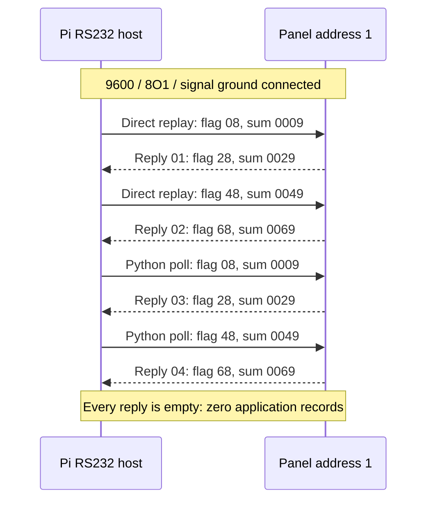

# Captured replies

Four featured responses from the physical RS232 session on 23 October 2026.

The full record contains **five received packets, two distinct RX byte patterns,
and zero application records**. The fifth packet is retained below and in the
[complete JSON capture](evidence/poll-replies.json). Transmitted requests are not
counted as replies.

| Capture setting | Value                                                                      |
| --------------- | -------------------------------------------------------------------------- |
| Serial          | 9600 baud · 8 data bits · odd parity · 1 stop bit                          |
| Address         | 1                                                                          |
| Total TX / RX   | 40 bytes / 40 bytes across five exchanges                                  |
| Checksum result | 5 of 5 valid                                                               |
| Context         | After the panel signal ground was connected to gateway RS232 signal ground |

> These replies establish communication during that session. They contain no
> alarm, reset, silence or power-fault records. A later completed post-reboot test
> returned zero bytes; see [Validation & limits](validation.md).

## Reply 01 · original-JAR bytes

Direct replay through the Pi UART. RX at +1.040362 seconds relative to session
start `2026-10-23T11:52:00.087970Z`; approximately 37.842 ms after the TX log.

```text
TX  02 00 08 00 01 00 09 03
RX  02 00 28 00 01 00 29 03
```

**Decoded:** address 1 · flag `28` · length 0 · checksum `0029` valid · no records.

## Reply 02 · original-JAR bytes

Direct replay through the Pi UART. RX at +6.060422 seconds from the same session
start; approximately 39.329 ms after the TX log.

```text
TX  02 00 48 00 01 00 49 03
RX  02 00 68 00 01 00 69 03
```

**Decoded:** address 1 · flag `68` · length 0 · checksum `0069` valid · no records.

## Reply 03 · Python driver

TX logged at **11:52:13.518 UTC**, RX logged at **11:52:13.559 UTC**.

```text
TX  02 00 08 00 01 00 09 03
RX  02 00 28 00 01 00 29 03
```

**Decoded:** address 1 · flag `28` · length 0 · checksum `0029` valid · no records.
The bus completed its pending poll and marked the panel online.

## Reply 04 · Python driver

TX logged at **11:52:13.613 UTC**, RX logged at **11:52:13.642 UTC**.

```text
TX  02 00 48 00 01 00 49 03
RX  02 00 68 00 01 00 69 03
```

**Decoded:** address 1 · flag `68` · length 0 · checksum `0069` valid · no records.
The bus completed its next pending poll.

## Four-reply sequence



Timing comes from software enqueue/log observations, not instrumented wire timing.
Direct replay refers to request bytes produced by the original JAR; it does not
mean the full Niagara runtime was running on the Pi.

## Complete capture, including reply 05

The third Python poll sent `02 00 08 00 01 00 09 03` at **11:52:13.696 UTC** and
received `02 00 28 00 01 00 29 03` at **11:52:13.720 UTC**. This is another empty
reply of the same first pattern.

| Received pattern          | Count | Application records |
| ------------------------- | ----- | ------------------- |
| `02 00 28 00 01 00 29 03` | 3     | 0                   |
| `02 00 68 00 01 00 69 03` | 2     | 0                   |

[Download all five replies as JSON](evidence/poll-replies.json). The export retains
protocol fields and timing, excluding network identifiers, credentials, personal
paths and unrelated process metadata.

## Separate JACE application-log evidence

These three payload transcriptions came from the supplied log photos. They are
**application subframes**, not complete RS232 RX envelopes, and are separate from
the five Pi replies above.

```text
09 21 25 00 29 69 B8 C2 05 02 1F 00
09 21 01 01 29 69 B8 C2 53 50 00 10 00
09 21 25 02 29 69 BA 1C 05 02 00 00
```

| Payload | Recovered interpretation                   |
| ------- | ------------------------------------------ |
| First   | Button code 5: reset indication, outcome 2 |
| Second  | Active occurrence 19: battery missing      |
| Third   | Another reset indication, outcome 2        |

Processing the first two records in order clears local state, then sets
battery-missing active. This is occurrence **19**, not occurrence 18 (power supply
fault). Envelopes built around the transcriptions in offline tests are synthetic.
The photos also include timeouts and an unknown record, so they do not establish
uninterrupted communication or current panel status.
