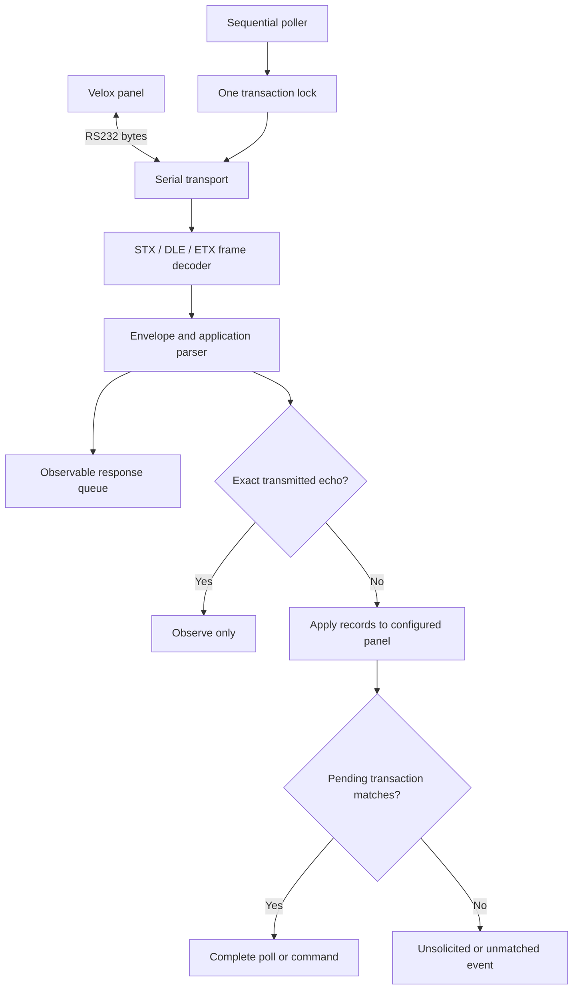

# Velox RS232 driver

A guide to the bytes, the state model, and the evidence behind the NETIX Velox driver.

**v0.2.0 · Python 3.11+ · Linux / macOS · Engineering preview**

The driver reconstructs a legacy Velox Java module as an asynchronous Python
package. It reads RS232 frames, sends serialized poll transactions, decodes
application records, and maintains configured point states and panel-fault flags.

> **Validation status · 26 October 2026**
>
> One physical session returned **five valid empty replies** at **9600 baud,
> 8O1, address 1**. The latest completed test after a reboot returned **zero RX
> bytes across 17 polls**. Sustained operation, real alarm delivery, and physical
> silence/reset effects remain unverified. An empty reply establishes communication
> at that moment; it does not prove the panel has no alarms or faults.

## How the driver works

| Component      | Responsibility                                                            |
| -------------- | ------------------------------------------------------------------------- |
| `transport.py` | Nonblocking serial I/O; UTC raw TX/RX logs and byte counters              |
| `codec.py`     | Request construction and incremental framing/unescaping                   |
| `protocol.py`  | Length checks, optional checksum validation, mixed record decoding        |
| `bus.py`       | Transaction lock, echo rejection, polling, command correlation, reconnect |
| `model.py`     | Configured point status and separate panel-fault booleans                 |
| `cli.py`       | Passive monitor, one-shot poll, continuous run and explicit controls      |

## Documentation

| Guide                                  | What it explains                                                          |
| -------------------------------------- | ------------------------------------------------------------------------- |
| [Protocol & architecture](protocol.md) | Frame anatomy, request sequence, framing and transaction state diagrams   |
| [Panel lifecycle](lifecycle.md)        | Startup, prealarm, fire, silence, restoration, reset, faults and recovery |
| [Captured replies](captures.md)        | Four featured physical replies and the complete five-reply dataset        |
| [Setup & usage](setup.md)              | Odd-parity configuration, CLI, Python point model and offline checks      |
| [Validation & limits](validation.md)   | Hardware evidence, Java parity, deliberate corrections and open gaps      |

## Captured configuration

| Setting                     | Value                                       |
| --------------------------- | ------------------------------------------- |
| Baud rate                   | **9600**                                    |
| Data / parity / stop        | **8 data bits · odd parity · 1 stop bit**   |
| Device address              | **1**                                       |
| Flow control                | Software and hardware flow control disabled |
| Default transaction timeout | 5 seconds                                   |

The provided `velox.9600-odd.toml` selects these serial settings explicitly. The
library's legacy default remains **no parity**. Physical setup included RS232 TX,
RX and signal ground during the successful capture.

## Scope

This is an event-fed integration model. It has no automatic point discovery,
initial status snapshot, event-history catch-up, persistent state, installed daemon
or MQTT/cloud publisher. Empty successful polls do not establish full panel state.

The [driver repository](https://github.com/NETIX-AI-OSS/velox-driver) is private.
This documentation and its sanitized captures are public. All pages are ordinary
Markdown with Mermaid diagrams, readable directly in
[GitHub](https://github.com/NETIX-AI-OSS/velox-driver-docs).
