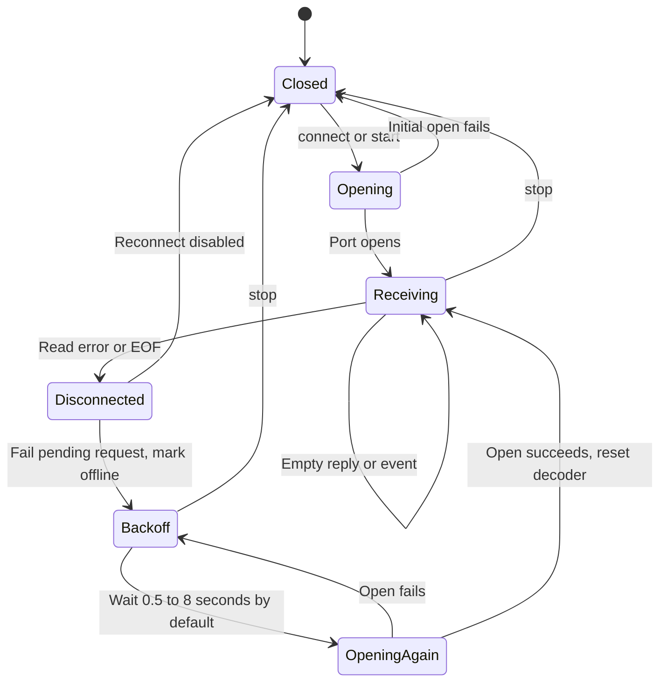
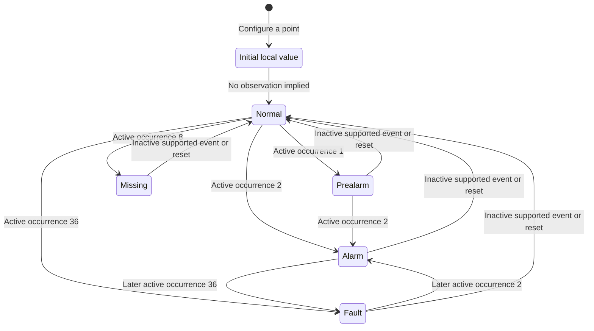
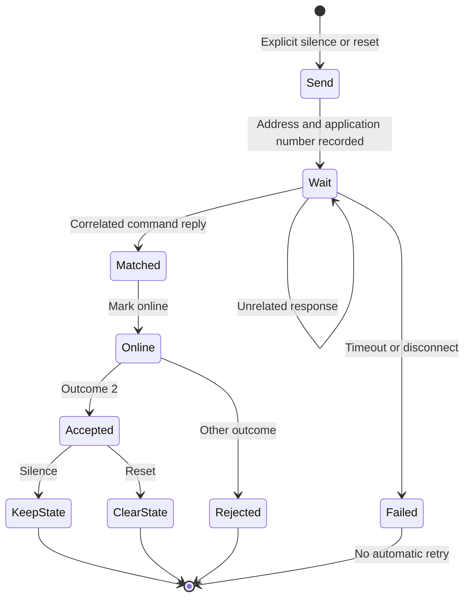
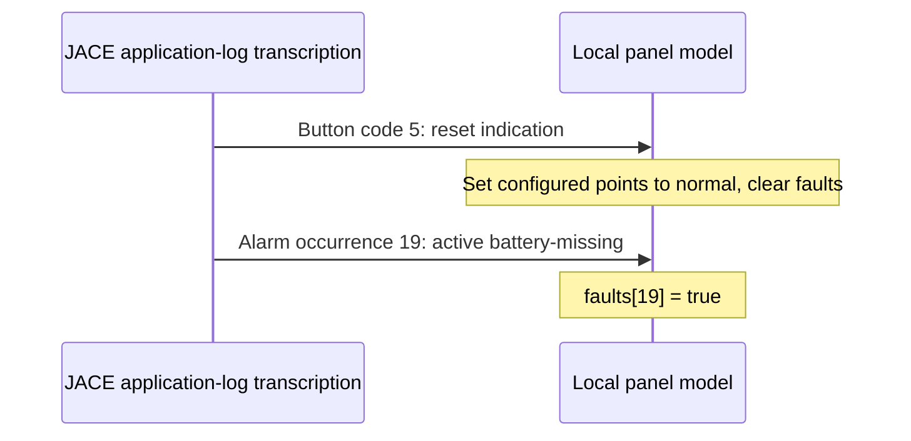

# Panel lifecycle

This describes the integration and its implemented state model. It does not
specify every internal panel/firmware transition or replace the panel's operating
instructions. Hardware evidence is limited to the empty replies in the validation
record. The stages below are model behavior unless explicitly marked observed.

## 1. Startup and communication

Load serial settings and panel addresses, configure point keys `(loop, device)` in
Python if point state is needed, then open the port. `connect()` starts the receive
task; `start()` also begins sequential polling. Panel `online` starts false.
Opening the port does not make the panel online. The first Q flag sent is 08,
then 48, alternating under a transaction lock. The default wait is five seconds.

A valid non-echo response from the expected address can complete a poll. Empty
replies were observed with flags 28 and 68. The implementation does not require
those exact flags. A completed matching transaction sets `online=true`; an empty
reply changes no alarm or fault state. This flag reflects transaction reachability,
not overall fire-system health or continuous freshness.

Connection state and panel `online` are separate: a timeout can mark a panel offline
while the port remains open. An initial open failure is returned to the caller.

## 2. Quiescent polling and events

`run` polls each configured panel sequentially, then waits `poll_interval` after
each scan. Events may arrive in a matched response or unsolicited. Known records
are applied in wire order. An unsolicited event may update state without setting
`online=true`. Echoes remain visible to observers but cannot complete requests or
update the model. Unknown records are preserved as raw data.

The integration has no initial snapshot or event-history query. A locally initialized
`normal` point and absence of an event do not prove that a detector is normal.

## 3. Prealarm and fire alarm

For a configured point with detector type 6 (input module) or 7 (detector), active
occurrence 1 sets `prealarm`; active occurrence 2 sets `alarm`. Fire can arrive
directly without a preceding prealarm. Both loop and device must match. Raw events
for unconfigured points remain visible, but do not create points automatically.

The model stores one status per point. A later supported active event overwrites
the prior status, so it cannot represent simultaneous alarm and fault states.

These are representative software transitions, not a required physical progression.
The model has one status slot and does not keep independent per-occurrence latches.

## 4. Acknowledgement and silence

There is no separate acknowledgement command in this implementation. An empty poll
response is a link response, not operator acknowledgement of a fire event.
`silence()` sends the original command layout, waits for a same-address reply with
a matching original-command number by default, and accepts outcome 2. Other
outcomes raise `CommandRejected`. No command is retried automatically.

A matched command response marks the panel online before its outcome is checked;
rejection therefore does not imply offline status.

The driver does not maintain sounder/acknowledgement state. Silence does not clear
its local alarm state. Command byte parity with Java is verified; the physical
panel's effect and its acknowledgement format have not been verified live.

## 5. Restoration and reset

An inactive supported point event sets that point to `normal`. Because there is
only one status slot, it can clear another current status too; no per-occurrence
latching is implemented. This is a limitation inherited from the reference model.

After an accepted `reset()` reply, the model resets configured points to `normal`
and clears its panel-fault dictionary. A received button record with command code
5 also resets local state, regardless of its outcome field, following the reference.
This is a software state change; it does not prove the underlying condition cleared.
A later active event can immediately reassert a fault or alarm.

The photographed JACE sequence illustrates ordering: reset indication, then active
battery-missing. Applying those records in order ends with battery-missing active.
That application-only transcription is distinct from the Pi's empty wire replies.

This sequence is derived from application-only log text. It is not a complete Pi
wire exchange and does not establish the current physical panel status.

## 6. Device and panel faults

Active occurrence 8 sets a configured point to `missing`; 36 sets `fault`. Inactive
events restore its single status to `normal`. Panel occurrences use separate flags:
17 battery low, 18 power supply fault, 19 battery missing, 59 charger fault, and
61 battery impedance fault. Their active/inactive transitions do not require point
configuration. The JACE photo's active occurrence is 19, not 18.

Loss of mains while the panel remains powered on battery could be reported as a
power fault if that firmware emits the mapped event. Complete loss of panel power
can instead appear as communication timeout. Neither event sequence was captured
live in the successful Pi session; zero RX alone cannot identify the physical cause.

## 7. Communication loss and recovery

A poll timeout sets that panel offline without reopening the port; a receive failure marks all panels offline
and fails any pending request. Reconnect attempts use exponential backoff, normally
0.5 to 8 seconds. Reopening resets the frame decoder; the next matching transaction
establishes online status. `monitor` does not use this reconnect supervisor.

Offline status does not clear point/fault values; treat those as historical and
possibly stale. There is no replay/catch-up protocol. On process restart the model
starts fresh, without persistent state. An initial open failure is returned to the
caller. Stopping cancels tasks, closes the port and marks panels offline.

The latest post-reboot test received zero bytes. A host or VPN heartbeat and
successful UART writes are separate from panel response validation.
