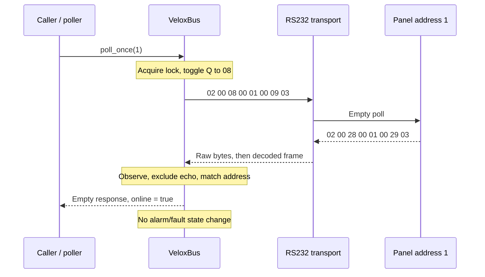
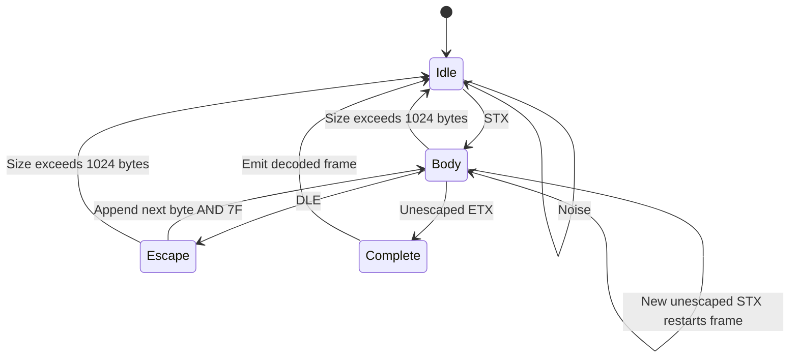
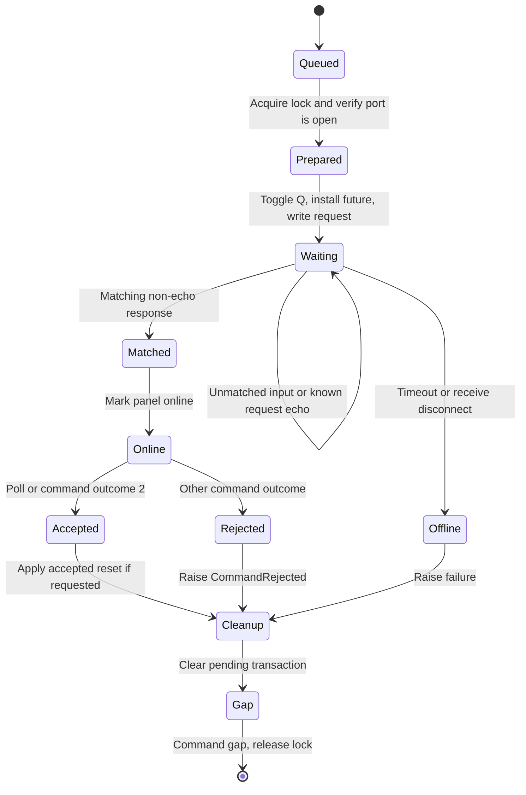

# Protocol & architecture

Follow one poll from the transaction lock to the wire, then through framing, decoding and correlation.

This describes the reconstruction and observed frames. It is not a complete
vendor protocol specification.

## A captured exchange



The next request uses Q=`48`; the observed response uses flag `68`. The driver
starts at Q=`48` internally and toggles before transmission, so its first request
uses `08`. All requests share one lock. Q is consumed even if a write fails.

## Empty-frame anatomy

```text
                    address   checksum
          length    high low  high low
          │         │    │    │    │
RX: 02    00    28   00   01   00   29   03
    │          │                        │
   STX        flag                     ETX
```

| Decoded offset | Field             | Meaning                                                |
| -------------- | ----------------- | ------------------------------------------------------ |
| 0              | `02`              | STX; start a frame                                     |
| 1              | Length L          | Decoded length must equal L + 8                        |
| 2              | Flag              | Host polls: `08` / `48`; observed replies: `28` / `68` |
| 3–4            | Address           | High then low byte; captured address is 1              |
| Last 3–2       | Additive checksum | High then low byte                                     |
| Last           | `03`              | Unescaped ETX completes a frame                        |

Empty envelopes have L=0 and contain no application records. Java command
requests have a special 31-byte layout; this table is not a general command builder.

## Checksum

Despite being named “CRC” in Java, the checksum is an additive 16-bit sum:

```text
sum(decoded_bytes[1 : L+5]) & 0xFFFF

Q=08 poll:  00 + 08 + 00 + 01 = 0009
Q=08 reply: 00 + 28 + 00 + 01 = 0029
Q=48 poll:  00 + 48 + 00 + 01 = 0049
Q=48 reply: 00 + 68 + 00 + 01 = 0069
```

Java transmit arithmetic treats bytes `80..FF` as signed. Receive validation uses
an unsigned sum. Both conventions agree for these empty frames. Receive checksum
checking is optional and **disabled by default**; all five captured replies pass it.

## Receive framing state machine



Partial bytes persist across reads. DLE sequences decode as `10 82 → 02`,
`10 83 → 03`, and `10 90 → 10`. Reopening resets the decoder. There is no independent
idle timeout for a partial frame; a new STX or size bound provides recovery.
Raw RX logging happens before parsing, including rejected bytes and noise.

Transmit writes the Java builder's literal byte array, including `10 83` inside
commands. A generic outbound stuffing pass would change reference behavior.

## Transaction state machine



The diagram shows the normal response and timeout paths. Opening/write failures
and cancellation also clean up pending state. Default timeout is 5 seconds;
default command gap is 50 ms. Commands are not automatically retried.

Poll correlation checks address and excludes exact current requests and previously
transmitted poll echoes. It **does not require flags 28/68 or matching Q**. A delayed
same-address reply can be ambiguous. Commands additionally match the decoded
original-command number by default; application number is fixed at zero unless an
unverified incrementing mode is enabled. Rejected commands still establish online.

## Application records

The response parser reads application data from decoded offset 13. Two bytes are
shared across records. The low nibble of shared byte 1 selects process type; the
low nibble of each record's first byte selects info type.

| Process / info | Record kind       | Bytes including shared 2 | Record stride |
| -------------- | ----------------- | ------------------------ | ------------- |
| 1 / 1          | Alarm or fault    | 13                       | 11            |
| 1 / 4          | Command reply     | 10                       | 8             |
| 1 / 5          | Button indication | 12                       | 10            |

Records may be mixed and are applied in order. A partial known record rejects the
response. An unknown type preserves the shared bytes and entire remaining payload
as an `unknown` record; no unproven length or meaning is invented.

| Record            | Relevant decoded fields                                                                                                    |
| ----------------- | -------------------------------------------------------------------------------------------------------------------------- |
| Alarm/fault       | Occurrence `data[8] & 3F`; positive transition is active; detector `data[9] & 0F`; loop `data[11] & 0F`; device `data[12]` |
| Command reply     | Outcome `data[8]`; original command number `data[9]`; outcome 2 is accepted                                                |
| Button indication | Command code `data[8]`; outcome `data[9]`; code 5 resets local state                                                       |
| Timestamp         | Big-endian seconds `data[4:8]` plus epoch offset `631144800`, copied from Java                                             |

Timestamp/clock interpretation is unverified. The legacy address builder truncates
to the low nibble, so configuration accepts 1–15 by default. Full-range addressing
is an unverified opt-in. See [validation](validation.md) for intentional corrections.
